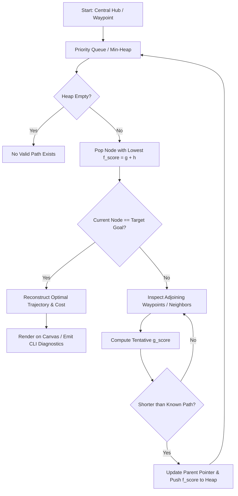

<div align="center">

# 🛰️ Autonomous Drone Delivery & Route Optimization Engine

**Heuristic Spatial Pathfinding & Energy-Efficient Waypoint Navigation**

[](https://www.python.org/)
[]()
[]()
[]()

</div>

---

## 📌 Overview

The **Autonomous Drone Delivery & Route Optimization Engine** is a spatial planning and trajectory optimization system designed for unmanned aerial vehicles (UAVs) performing multi-point package deliveries. 

Given a central dispatch hub (warehouse) and a network of delivery destinations with topological constraints, the system models the airspace as a weighted coordinate graph. It computes the globally optimal, collision-free delivery trajectory using the **A\* heuristic search algorithm** to identify the lowest-cost delivery path across the network.

---

## 🚀 Key Features

- **Admissible Heuristic Spatial Search:** Employs an exact Euclidean distance heuristic guarantee ($h(n) \le d(n, \text{goal})$), ensuring $A^*$ path optimality.
- **Dual Execution Modes:**
  - **Interactive Tkinter Visualizer:** Real-time 2D canvas displaying nodes, weighted spatial edges, and dynamic route highlighting.
  - **Headless CLI:** Scriptable command-line interface for automated batch evaluations and integration pipelines.
- **Flexible Network Graph:** Decoupled data model supporting arbitrary waypoint topologies, custom transit costs, and dynamic obstacles.
- **Comprehensive Analysis:** Includes Jupyter Notebook environment for algorithmic experimentation and benchmark comparisons.

---

## 🏗️ Architecture & Navigation Workflow



---

## 📐 Mathematical Formulation

The path evaluation function $f(n)$ balances cumulative transit expenditure against remaining estimated displacement:

$$f(n) = g(n) + h(n)$$

Where:
- **$g(n)$**: The exact cumulative distance / energy cost traversed from the initial warehouse $W$ to node $n$.
- **$h(n)$**: The straight-line Euclidean distance heuristic to the destination $(x_{\text{goal}}, y_{\text{goal}})$:

$$h(n) = \sqrt{(x_n - x_{\text{goal}})^2 + (y_n - y_{\text{goal}})^2}$$

Because straight-line distance represents the shortest physical distance between two spatial points in flat Euclidean space, $h(n)$ is strictly **admissible** ($\forall n: h(n) \le h^*(n)$) and **consistent**, mathematically guaranteeing that the first time the goal state is expanded, its path is guaranteed to be optimal.

---

## 📂 Repository Structure

```plaintext
Drone_Delivery/
├── docs/
│   └── drone_delivery_system_design.pdf   # Architectural specification & requirements
├── notebooks/
│   └── drone_delivery_astar.ipynb         # Interactive research & visualization notebook
├── src/
│   ├── __init__.py                        # Package definitions & exported modules
│   ├── router.py                          # Core A* search algorithm & topological model
│   └── gui.py                             # Tkinter interactive canvas visualizer
├── .gitignore                             # Standard Python & IDE ignore patterns
├── main.py                                # Primary entry point (GUI + CLI flags)
└── README.md                              # Technical documentation
```

---

## ⚡ Quickstart & Usage

### 1. Prerequisites
- Python 3.8 or higher (Tkinter is included in standard Python distributions on Windows/macOS).

### 2. Run Interactive GUI Visualizer
Launch the visual canvas interface to select start and destination waypoints dynamically:

```bash
python main.py
```

### 3. Run Headless CLI Mode
For automated testing or benchmark logging without opening a graphical window:

```bash
# Calculate optimal route from Warehouse (W) to Goal Destination (E)
python main.py --cli --start W --goal E
```

**Sample Output:**
```text
========================================================
 Autonomous Drone Route Optimization - Path Evaluation
========================================================
Origin (Warehouse / Waypoint): W
Target Destination:            E

 Status:      OPTIMAL PATH FOUND
 Waypoints:   W -> C -> E
 Total Cost:  960.00 distance units
 Step Count:  2 transitions
========================================================
```

---

## 👨‍💻 Author

**Mahamat Ahmat**  
*M.Sc. Artificial Intelligence Engineering — University of Passau*  
*B.Sc. in Artificial Intelligence — Cairo University*

- 🌐 **Portfolio:** [mohamedgpt.me](https://mohamedgpt.me)
- 🐙 **GitHub:** [@mahamadAhmed](https://github.com/mahamadAhmed)
- 💼 **LinkedIn:** [Mohammed Ahmed](https://www.linkedin.com/in/mohammed-ahmed-96b023234)
